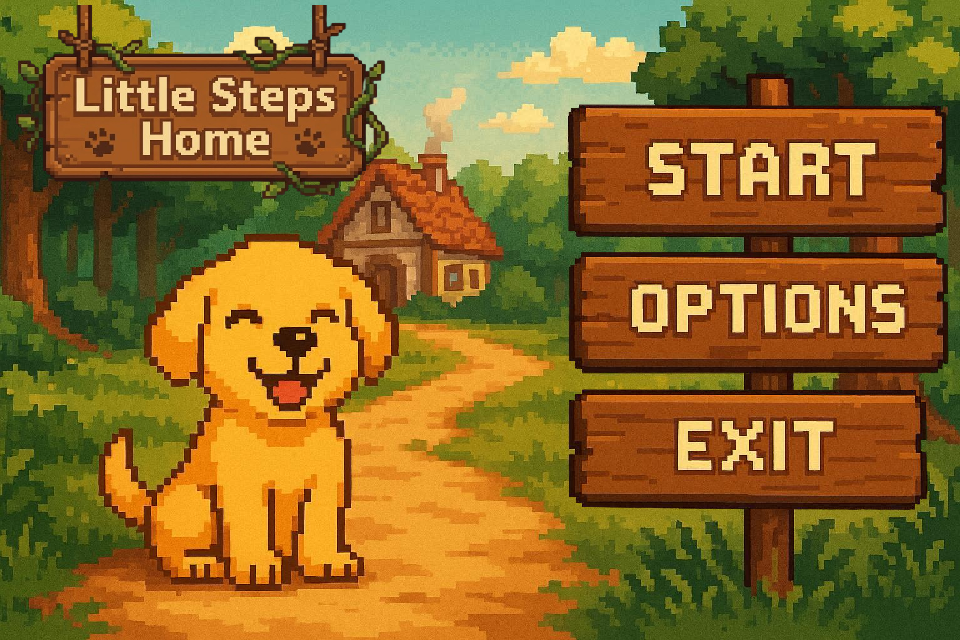
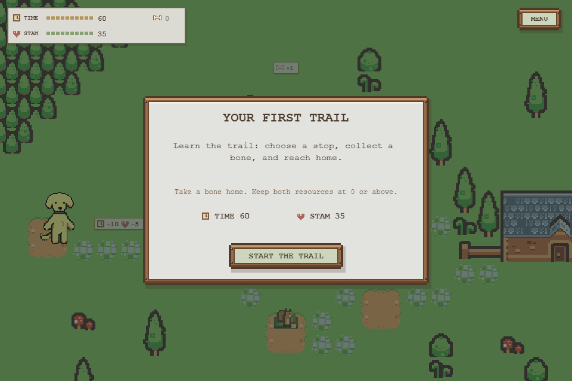
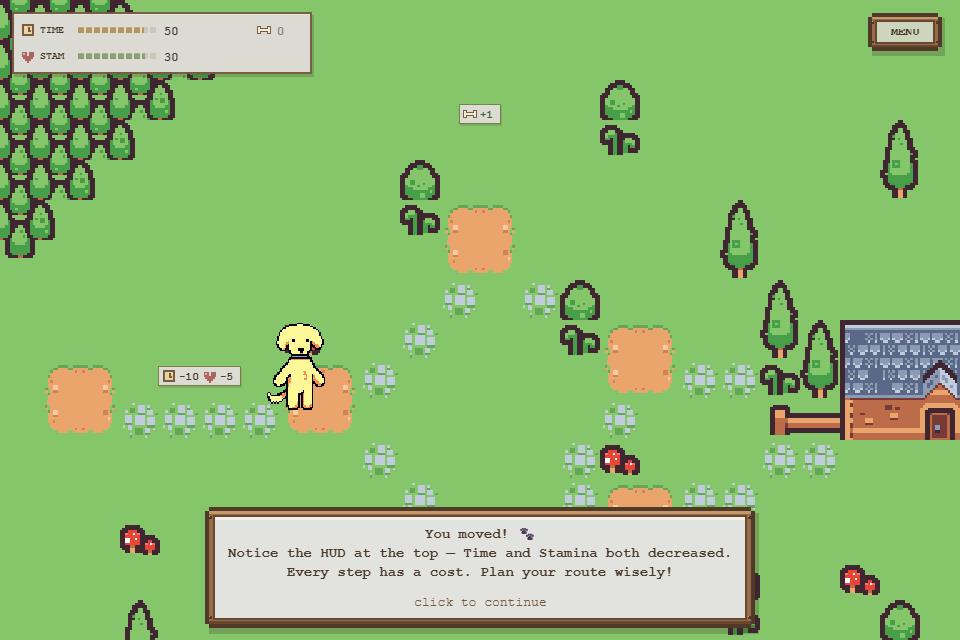
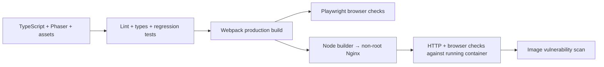

# Little Steps DevOps

[](https://github.com/meng81593-byte/little-steps-devops/actions/workflows/quality.yml)


A hands-on DevOps portfolio project around **Little Steps Home**, a Phaser browser game in which a puppy must reach home while managing time, stamina, and route choices.

**[Play the HTTPS demo](https://meng81593-byte.github.io/little-steps-devops/)** · [Quality checks](https://github.com/meng81593-byte/little-steps-devops/actions/workflows/quality.yml) · [Verified AWS release](https://github.com/meng81593-byte/little-steps-devops/actions/runs/38591646137)

The application started as a **team project**. My initial contributions were the game concept, page/interface design, route design, visual design, and backgrounds. I subsequently continued updating the project and developed its container and delivery workflow. See [project credits](docs/credits.md) for the contribution boundary and asset licensing status.

## What this project demonstrates

- Reproducible Node.js 24 builds using `npm ci` and a committed lockfile.
- TypeScript linting, type checks, and regression tests for resource rules and winning budgets.
- Production browser checks with Playwright, including asset loading.
- Multi-stage Docker packaging with non-root Nginx on port 8080 and a `/healthz` endpoint.
- GitHub Actions checks for dependency vulnerabilities, builds, running containers, browser behavior, and fixable high/critical image vulnerabilities.
- Documented delivery and operations work, linked to the [Terraform network project](https://github.com/meng81593-byte/aws-terraform-network-lab).

The application is static. It does not require a backend, database, or runtime AWS API permissions. AWS container deployment is an operations exercise; static hosting is sufficient for a permanent game demo.

## Game preview





The updated game keeps its woodland pixel interface, puppy customization, exploration fog, and sequential trail unlocks. The authored rules, route tradeoffs, and research boundaries are documented in [game design notes](GAME_DESIGN.md).

## Architecture



## Run locally

Prerequisites: Node.js **24.x**, npm, and optionally Docker for the container exercise.

```bash
git clone https://github.com/meng81593-byte/little-steps-devops.git
cd little-steps-devops
npm ci
npm run dev
```

Open [http://127.0.0.1:8080](http://127.0.0.1:8080). The development server binds to loopback. Webpack watches source changes; refresh the browser after each successful rebuild.

## Verify a change

```bash
npm run lint
npm run typecheck
npm test
npm run test:game
npm audit --audit-level=high
npm run build
npx playwright install chromium
npm run test:e2e
```

The standalone game checker verifies all playable trail budgets, the deterministic chase route, and sequential unlocks. Playwright starts a local server for the production `dist/` assets and plays the tutorial through collecting a bone, reaching home, and opening the next trail. In Linux CI, install browser dependencies using `npx playwright install --with-deps chromium`. Test traces and failure screenshots are retained in CI artifacts.

## Run the container

```bash
docker build -t little-steps:local .
docker run --rm -d --name little-steps -p 127.0.0.1:8080:8080 little-steps:local
```

Open the game or request `/healthz`. Stop it when finished:

```bash
docker logs little-steps
docker stop little-steps
```

The runtime serves only generated assets, listens on a non-root port, and runs as the image's unprivileged user. Base images track maintained release tags; deployment should record the resulting image digest.

## Repository map

- `src/little-steps-client/`: scenes, levels, assets, and resource analysis.
- `tests/unit/`: resource and budget regressions.
- `tests/e2e/`: production browser verification.
- `scripts/`: local serving and development tooling.
- `Dockerfile` and `nginx.conf`: runtime packaging and health endpoint.
- `.github/workflows/quality.yml`: quality and running-container checks.
- `.github/workflows/publish.yml`: manually publish a verified immutable ECR image using GitHub OIDC.
- `.github/workflows/deploy.yml`: deploy a verified digest to the existing ECS experiment, preserving a rollback reference.
- `docs/`: credits, validation evidence, and operational notes.

## Analysis limits

The budget engine retains Pareto tradeoffs between time and stamina rather than combining incompatible routes. Its graph models adversarial defender choices and monotone bone collection. The game also has interactive trap behavior and a greedy cat, so displayed budgets are resource estimates for the graph model, not a guarantee that every live-play strategy succeeds. See [validation notes](docs/validation.md).

## Deployment and evidence

The previous README linked to another account's Pages site. That link is not presented as deployment evidence for this repository. Current validation evidence and deployment progress are recorded in [validation notes](docs/validation.md). AWS experiments must be cleaned up after verification; do not leave a learning environment running unattended.
