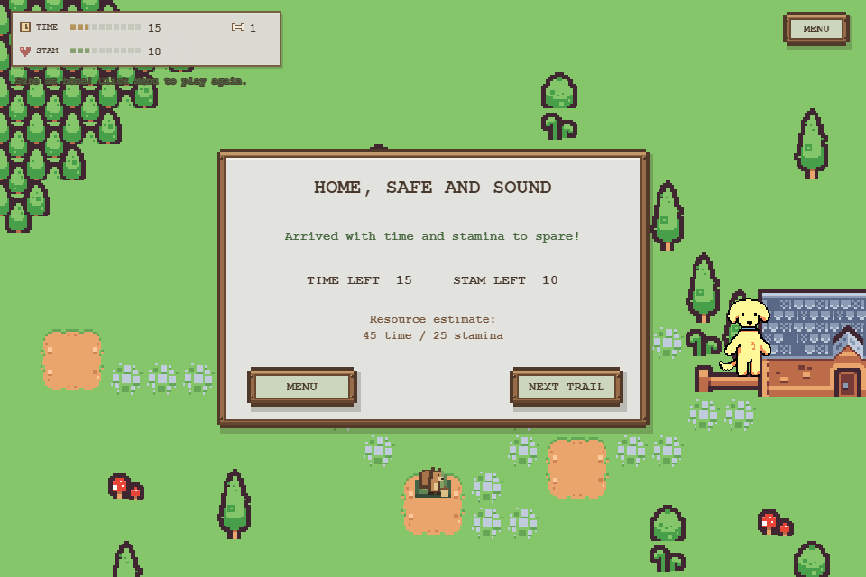
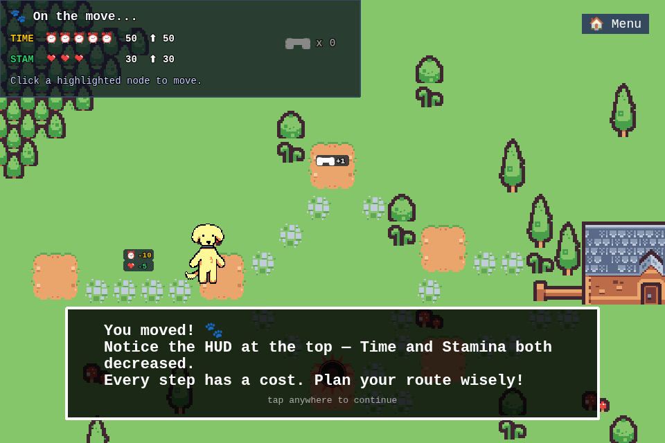

# Validation and limitations

Review date: 14 October 2026.

Local verified results during this update:

- Node.js 24.12.0; TypeScript type check passed.
- ESLint with TypeScript rules passed after addressing unchecked casts and unused code.
- Twelve unit/regression tests passed, including all four shipped level definitions.
- Production Webpack build passed.
- `npm audit` reported zero vulnerabilities after removing the proxy-based development server and updating dependencies. This is a point-in-time dependency audit, not a guarantee of future vulnerability status.

The local production browser assertions passed on 14 October 2026 using Chrome: menu rendering, level selection, both tutorial prompts, and the first move from node 0 to 1. Time changed from 60 to 50 and stamina from 35 to 30, without page errors or missing assets. The local Windows browser teardown was slow; the authoritative complete runs are the passing Linux CI jobs below.

## Verified delivery evidence

### Pixel UI integration, 14 October 2026

The later local integration combines the wood-framed pixel UI and authored trail updates from `save-pixel-ui` with the engineering changes on main at `ed034e7`. Node.js 24 type checks, lint, all twelve existing regression tests, the standalone game checker, and the production build passed. The browser assertions also passed using real pointer input: tutorial introduction, movement, bone acquisition, arrival at home with `(time=15, stamina=10, bones=1)`, saved tutorial completion, and opening the next trail. On this Windows host, browser cleanup did not finish after Playwright reported the test as successful, so the runner was stopped. A complete CI run for this integration remains pending publication.

The checker covers Pareto tradeoffs, defender exits, resource caps, the first three playable trail budgets, the authored cat route, and sequential progression. It is included in the quality, Pages, and image-publication workflows. These local checks validate the integrated source; the AWS and CI records below describe the earlier published release and must not be read as a cloud deployment of this UI integration.

### Earlier published release

- [Quality and running-container checks](https://github.com/meng81593-byte/little-steps-devops/actions/runs/38596968245): dependency audit, lint, strict types, twelve unit tests, production build, browser interaction, non-root Nginx, HTTP assets, container browser interaction, and fixable HIGH/CRITICAL image findings gate passed. Unfixed image vulnerabilities are outside that gate; this is not a claim of zero CVEs in every dependency/image component.
- [OIDC image publication](https://github.com/meng81593-byte/little-steps-devops/actions/runs/38588609301): commit `7b87c59cb2fd990ec0bc5426cb4e613412a5716f` published to immutable ECR tag and digest `sha256:4a0d13134a03da5990ec23c95bcaf8105e5d61f56574ddfbfc399d0aa5d9461f`.
- [OIDC ECS release](https://github.com/meng81593-byte/little-steps-devops/actions/runs/38591646137): requested task revision became stable, endpoints passed and the same browser interaction passed against the real AWS URL. Artifacts are retained for seven days; the job logs and permanent repository evidence document the result afterward.
- Failed-health revision 2 triggered automatic rollback to completed revision 1. A subsequent workflow deployed verified revision 3. All experiment AWS resources, images, task revisions, roles and temporary repository variables were removed on the same day; the original network remained.
- Sanitized network, recovery and cleanup records are retained in the [network verification document](https://github.com/meng81593-byte/aws-terraform-network-lab/blob/main/docs/verification.md).

The [permanent HTTPS game demo](https://meng81593-byte.github.io/little-steps-devops/) is separate from the temporary AWS experiment. Its static availability file is `healthz.txt`; Nginx and ALB use `/healthz`. Published-site browser checks use the project's URL prefix.

[Published-site verification](https://github.com/meng81593-byte/little-steps-devops/actions/runs/38597626143) passed after HTTPS Pages deployment, including tutorial navigation and the first move. The image below was retained from the successful browser test against the temporary AWS service:

## Budget regression examples

Two paths requiring `(time=1, stamina=10)` and `(time=10, stamina=1)` must retain both budgets. `(1,1)` is not a valid winning budget. Defender nodes require a budget sufficient for every outgoing choice. Unreachable goals remain unreachable even with positive resource cycles. Goal feedback requires both a reached goal and a bone.

The solver uses graph reachability rather than a complete simulation of interactive traps and cat decisions. It returns a convergence flag; no exact mathematical claim should be made for a graph that hits the iteration guard.
